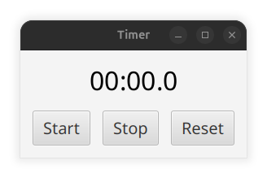
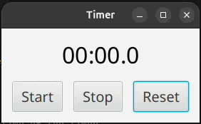
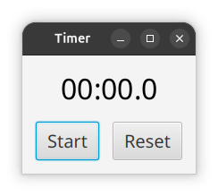
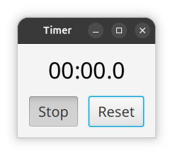
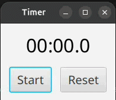

# Lab 8 - JavaFX

**Author**: Jon Mrowczynski

---

## 1. Intro - Software Architecture Layers

We have encountered some software architectural layers without explicitly mentioning their names:

1. The **application layer**, sometimes called the **business logic layer**, is the Java code that the user will never
   see and never directly interact with. However, it handles (and **should only** handle) the backend processes of an
   application. Kind of like how a stage crew works behind the scenes for a play.

2. The **testing layer** sometimes isn't considered its own layer since it shouldn't be shipped with an application.
   However, it is substantial enough and should be separate from the application code such that thinking about it as
   a layer is sufficiently valid.

3. The **presentation layer** is the interface that the user interacts with. So far, we have just been using and
   writing command-line interfaces (or CLIs). However, we will dive into the realm of using and writing graphical
   user interfaces (or GUIs)!

4. Finally, the potentially new layer we'll talk about is what's sometimes called the **coordination layer** or the
   **presentation logic layer**. More colloquially, this is sometimes called the **glue layer,** and you might hear 
   talking about "glue code". It interfaces the pure back-end logic code to the presentation layer.

Initially, it might make more sense to simply integrate the application layer with the presentation layer to seemingly
improve and simplify your app. Rather, why have so many layers? Doing so tends to simplify successfully testing, 
debugging, and maintaining your codebase, making development much easier in the long-run!

Take a look at `Timer` in the `businesslogic` package. While it is similar to our `ElapsedTimer` in a previous lab,
there are some noticeable differences. For example, it just returns the amount of elapsed time between start and
stop and not an averaged elapsed time between starts and stops.

### Q1: Even though `Timer`'s fields are protected, is encapsulation still used?

[Answer Here]

## 2. [JavaFX](https://openjfx.io/)

Is probably one of the most powerful, user-friendly frameworks for developing GUI applications for various platforms. 
It has a rich API, but we only have time to cover the basics of FXML (JavaFX's presentation layer) and how to connect 
it to our business logic layer (our application code) through what JavaFX calls "Controllers".

### Q2: What layer would "Controllers" fall into based on the info above?

[Answer Here]

Open `TimerAppLauncher`. This class serves as our entry point to our JavaFX application, which is identifiable
because `TimerAppLauncher` `extends`...well...`javafx.application.Application`! We will soon run this class, but notice 
that it is missing something that's been present in all of our previous runnable Java programs.

### Q3: What is this missing piece in `TimerAppLauncher`?

[Answer Here]

## 2.1 Running a JavaFX Application

We're going to need the power of Gradle to help us run JavaFX applications. Open your Gradle Tasks Pane by clicking 
on the elephant in the right sidebar and navigate to `CSC213LAB8 -> Tasks -> application`. Double-click the "run" 
Gradle Task and a window similar to below should pop up:

This is our Timer app!

- Note we can only run our JavaFX Application because in our `build.gradle.kts` file we:
    1. are using the "application" Gradle plugin and
    2. declared that `TimerAppLauncher` is the main class that we want to run.

Play around with the timer. Notice repeated clicks of "Start" and "Stop" make the timer behave a 
bit weirdly. Let's fix this by:

### Task 1: Implementing a `RobustTimer`

`RobustTimer` should make repeated presses of the "Start" and "Stop" buttons no-ops. While you can implement this in
many ways, let's practice some OOP:

1. Extend `Timer`.
2. Override the `start` and `stop` methods
3. Add the additional/modified functionalities stated above to those overridden methods.
4. Call the super class's `start` and `stop` methods inside the corresponding overridden methods.

This should result in a very simple implementation for `RobustTimer`. For example, **it's possible to implement all 
this with only 3 lines of code**.

Since `Timer` is part of our business logic layer and `RobustTimer` is an extension of `Timer`...

### Q4: What package should `RobustTimer` be placed in?

[Answer Here]

Usually we should write tests to help us test our code. Here, we will just test it manually through the timer app.

Open `TimerController` in the `controller` package. You may be unfamiliar with much of the code in this class. We will
talk about what is going on later. For now, notice that a `Timer` object is declared in this class and instantiated in
the `public` constructor.

### Task 2: Change the instantiated type from `Timer` to `RobustTimer`.

- **You should only be changing one line of code for this task.**

Why do you only need to change this one line of code? Rather, asked differently...

### Q5: What OOP idea are we using that allows us to just change this one line of code?

**Hint:** It is not inheritance.

[Answer Here]

Run the timer app again and check to ensure that repeated "Start"s and "Stop"s don't cause our timer to behave
strangely. You should have something that works like so (ignoring the GIF video quality/FPS drop):

## 3. [FXML](https://docs.oracle.com/javase/8/javafx/api/javafx/fxml/doc-files/introduction_to_fxml.html)

While we fixed our app by implementing code in our business logic layer, we could have instead changed the UI! The 
problem with the UI is that we present "Start" **and** "Stop" buttons. What if we presented only one at a time? Like so:

And then after "Start" has been pressed, it starts the timer and the button's text switches to "Stop":

such that when "Stop" is pressed, it stops the timer and switches the button's text back to "Start". In essence, we
replace the 2 "Start" and "Stop" Buttons with 1 Toggle Button.

Open `src/main/java/resources/toggle-timer.fxml` and examine this FXML. You may notice some red text in this file. 
We will worry about that later. For now Replace the TODO comment with a `ToggleButton`. Use the `Button`s in 
`src/main/java/resources/timer.fxml` as a template for what attributes to set for your `ToggleButton`. However, make 
sure to give it a(n):

1. fx:id of `startStopButton`
2. onAction handler named `handleStartStop`
3. appropriately set font 
4. starting text
5. appropriate `GridPane` position so that it doesn't overlap the displayed time!

Now, we can fix the red text by

### Task 3: Implementing a `ToggleTimerController`

### Q6: What package should `ToggleTimerController` be placed in?

[Answer Here]

`ToggleTimerController` should:

1. Extend `TimerController`.
2. Inject `startStopButton`. (Look to see how `TimerController` injects the `Text` `duration`)
3. Declares a `public` constructor that initializes `timer` to a new `Timer`.
   - **You should not modify `TimerController` to accomplish this.**
4. Implements the `handleStartStop` method that:
   - Starts the timer and switches the `ToggleButton`'s text to "Stop" when it has been selected.
   - Stops the timer and switches the `ToggleButton`'s text to "Start" when it has been deselected.
   - Note `ToggleButton`'s have methods `isSelected` and `setText`. ;)

**Do not reinvent the wheel**. Make sure to call the super class's `handleStart` and `handleStop` methods.

### Q7 (2pts): Does it matter which `Timer` object is used in step 3 above and why?

[Answer Here]

Finally, change the loaded FXML file in `TimerAppLauncher` from `timer.fxml` to `toggle-timer.fxml`, rerun the 
app, and test it out! You should have a similarly functioning Timer app as shown below:

### Bonus (3pts): What is the purpose of `scheduledRunnable.run()` in the `handleReset` method?

**Hint**: If you comment out this line of code, run the app, and press the "Reset" button under different conditions 
what do you see? 

[Answer Here]

## Submission:

ZIP your `CSC213LAB8\src\main` folder and submit it along with your README.md to the corresponding D2L dropbox.  

